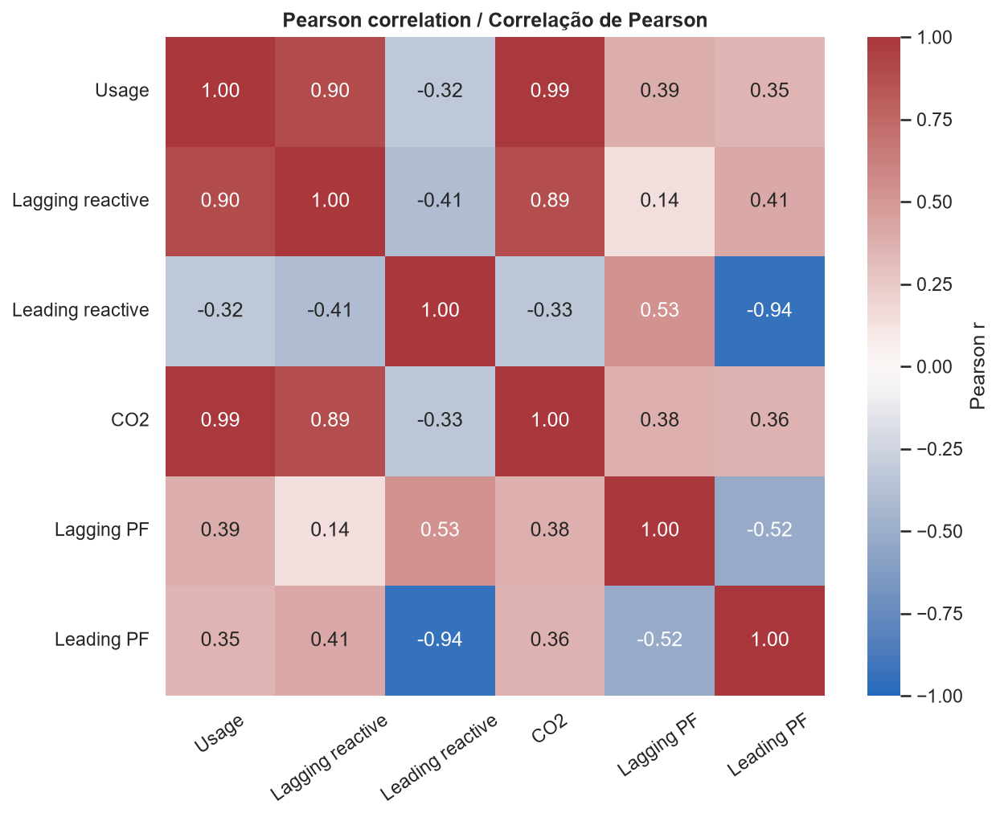
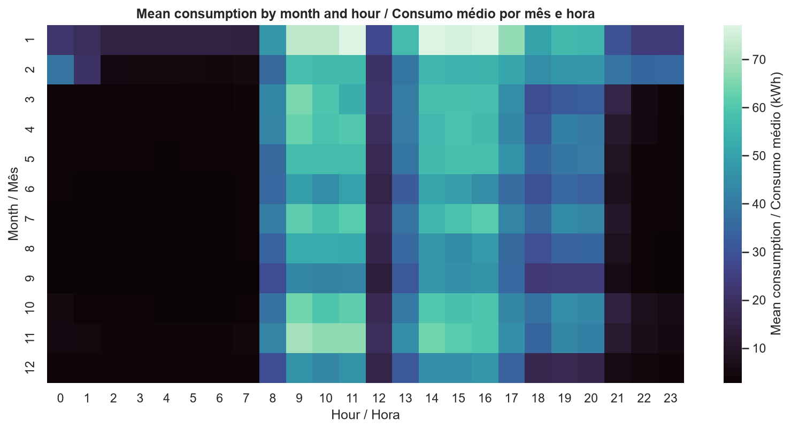
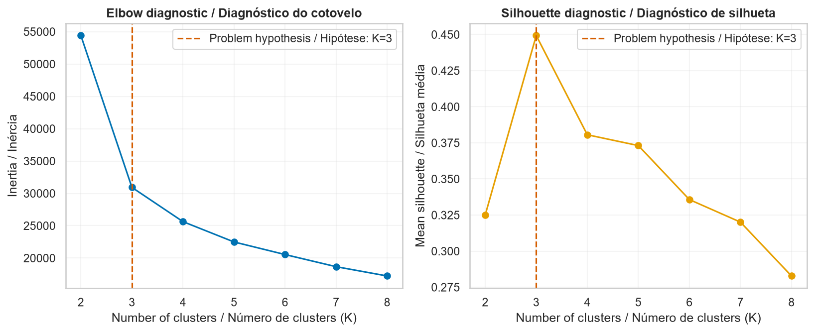
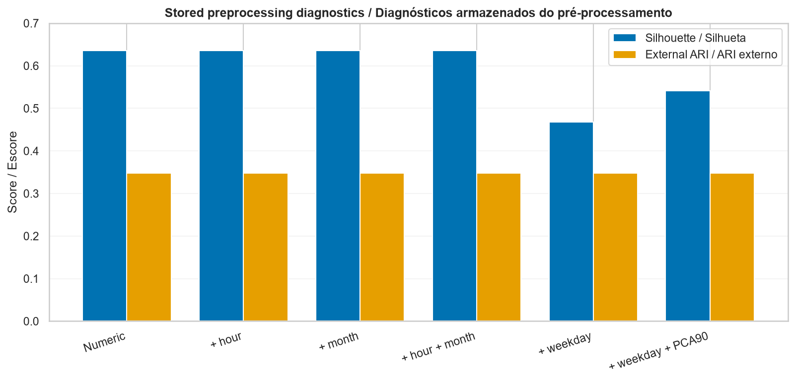

# Initial Findings

!!! warning "Exploratory evidence"
    These observations come from the current EDA and regenerated local artifacts.
    They are not frozen evaluation results or production recommendations.

## Dataset profile

- 35,040 measurements and 11 columns;
- no missing or exact duplicate rows;
- 15-minute frequency across 2018;
- 25,056 weekday and 9,984 weekend observations;
- Load_Type counts: 18,072 Light_Load, 9,696 Medium_Load, and 7,272 Maximum_Load.

## Distribution impressions

Usage, lagging reactive energy, leading reactive energy, and CO2 are right-skewed.
Leading power factor is strongly left-skewed. The IQR rule marks about 23.8% of leading
power-factor observations and 22.1% of leading reactive-energy observations as extreme;
this reflects distribution shape and must not be interpreted as the same thing as an
operational anomaly.

## Relationship impressions

The current Spearman diagnostics show:

- strong positive association between Usage_kWh and CO2, approximately 0.88;
- positive association between usage and lagging reactive energy, approximately 0.64;
- strong inverse association between leading reactive energy and leading power factor,
  approximately -0.97;
- clear hour-of-day and weekday/weekend structure in mean consumption.

These relationships motivate scaling, redundancy checks, and temporal stability tests.

*Figure 1 — Pearson correlation calculated from the raw numerical variables, with
`Load_Type` excluded. It supports the redundancy warning for consumption and CO2 and
the strong inverse relationship between leading reactive energy and leading power
factor; correlation does not imply causation.*

*Figure 2 — Mean `Usage_kWh` by month and hour. The repeated morning and afternoon
blocks support the temporal-pattern impression, while the heatmap alone cannot identify
their operational cause.*

## Multivariate impressions

The first two PCA components explain approximately 73.4% of transformed-space variance.
PCA and t-SNE show structured regions, but projections do not prove the existence or
business meaning of clusters.

For K-Means diagnostics on a reproducible sample, K=3 has the highest tested silhouette,
approximately 0.449. The full three-cluster baseline currently contains 13,074, 14,378,
and 7,588 observations. This supports continued investigation but is not external
validation.

*Figure 3 — Stored K-Means diagnostics from notebook 01. K=3 is both the problem
hypothesis and the highest silhouette among K=2…8 in this execution; this supports a
plausible segmentation, not equivalence with the external `Load_Type` categories.*

For the GMM diagnostic, BIC continues improving through eight tested components while
the problem-constrained model remains fixed at three. This suggests statistical
substructure inside the three operational regimes rather than evidence that the business
problem has eight regimes.

Isolation Forest flags 701 observations under an assumed contamination rate of 2%.
Those records are investigation candidates, not confirmed faults.

## Next checks

These checks were addressed in [Data Preparation](data-preparation.md),
[Modeling](modeling.md) and [Evaluation](evaluation.md).

- reproduce preparation outside the EDA notebook;
- measure cluster stability under resampling and time splits;
- test sensitivity to feature groups and transformations;
- define a frozen external-evaluation protocol;
- resolve the CO2 unit wording;
- avoid turning exploratory labels into supervised training prematurely.

## Evidence by notebook

| Notebook | Evidence currently available | Interpretation status |
| --- | --- | --- |
| `01_EDA.ipynb` | data audit, distributions, calendar profiles, correlations, PCA/t-SNE, K-Means, GMM, and Isolation Forest | exploratory |
| `02_preprocessing.ipynb` | temporal split, feature configurations, fitted preprocessing, PCA, cluster stability, and exported artifacts | experimental; selection not frozen |
| `03_Modeling.ipynb` | reserved structure and TODO | no model result yet |

The stored EDA execution also reports no duplicated timestamps, a constant 15-minute
interval, and recurring activity peaks around 9–11 a.m. and 2–5 p.m. Weekday medians
are 7.60 kWh for consumption and 5.80 kVarh for lagging reactive energy, compared with
3.46 kWh and 3.02 kVarh on weekends. These are descriptive operating patterns, not
causal explanations.

## Preprocessing notebook impressions

The stored execution of `02_preprocessing.ipynb` uses a chronological 80/20 split:
training runs from 2018-01-01 through 2018-10-19, and testing runs from 2018-10-20
through 2018-12-31.

| Feature configuration | Silhouette | ARI against the external categories |
| --- | ---: | ---: |
| Numeric baseline | 0.6361 | 0.3482 |
| Numeric + hour + month | 0.6361 | 0.3482 |
| Numeric + `Day_of_week` | 0.4680 | 0.3476 |
| Numeric + `Day_of_week` + PCA 90% | 0.5409 | 0.3478 |

*Figure 4 — Scores stored by notebook 02. The chart makes the selection tension visible:
the numeric baseline has the highest silhouette, while external ARI changes very little
among the tested configurations.*

The fitted PCA pipeline retains six components for 90% explained variance and reports a
maximum inter-component correlation of 0.0 after rounding. Across subsamples, the final
three-cluster configuration reports ARI stability of 0.9983 ± 0.0015, which is strong
evidence of repeatability for that specific pipeline and sample protocol.

The excluded reporting variables still distinguish the fitted clusters: mean CO2 varies
from 0.000 to 0.031 tCO2, while mean leading power factor varies from approximately
38.716 to 99.991. This supports post-fit interpretation, but does not establish causal or
business validity.

!!! caution "Selection remains open"
    The numeric baseline has a higher silhouette than the PCA configuration selected in
    the notebook. Hour and month features also leave the stored baseline scores unchanged.
    The final choice therefore needs a documented multi-criterion rationale and a check
    that every candidate actually received the intended feature columns. ARI is reported
    only as external diagnostic evidence and must not drive unsupervised fitting.

## Modeling notebook status

`03_Modeling.ipynb` explicitly states that it has no results in the current version. No
final-model performance, production threshold, or frozen external evaluation should be
inferred from the EDA or preprocessing notebooks.

