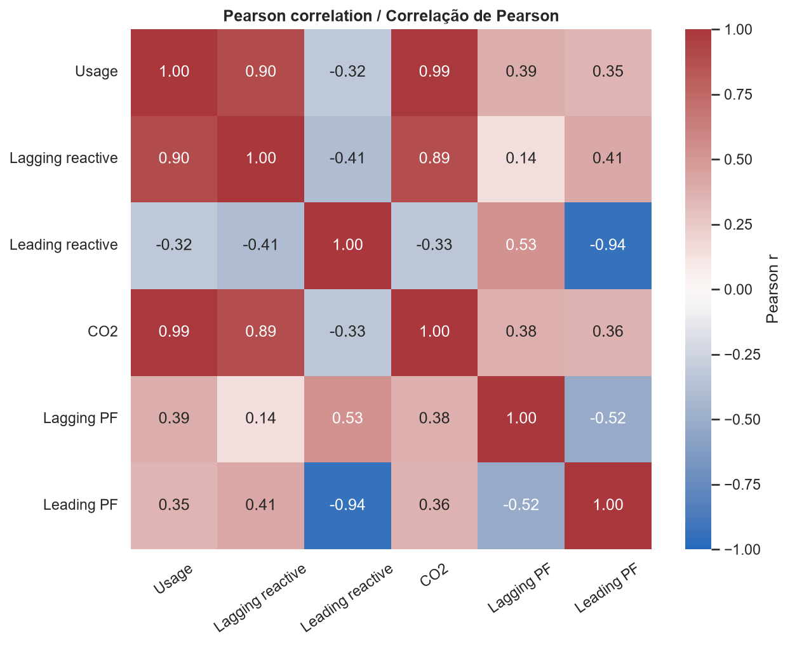
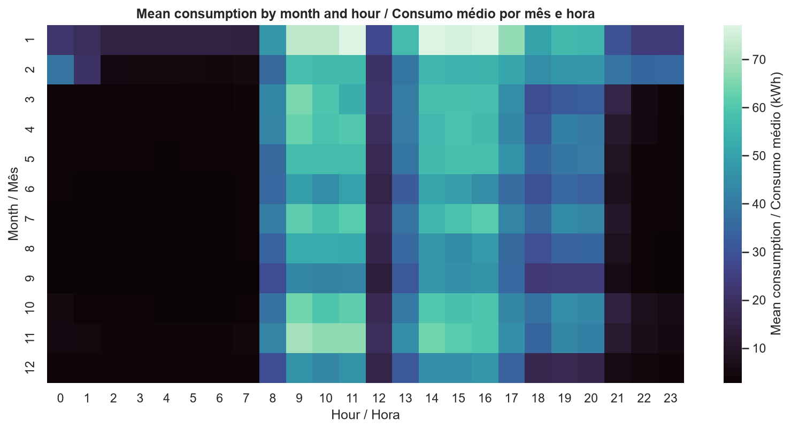
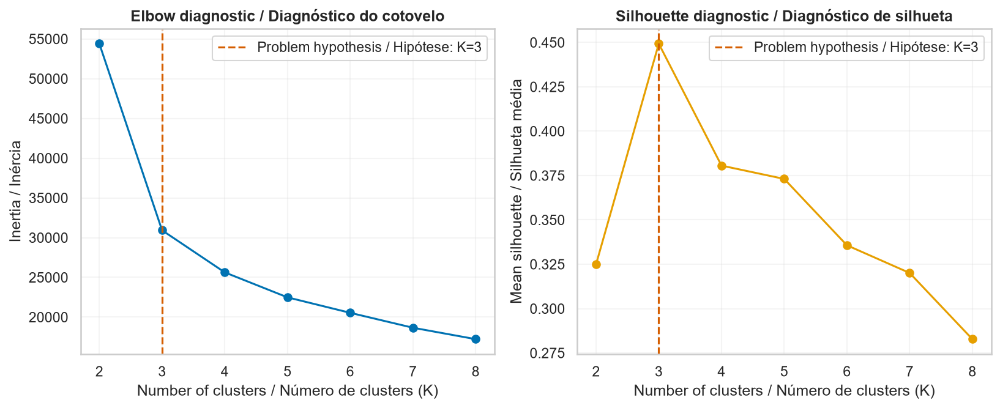
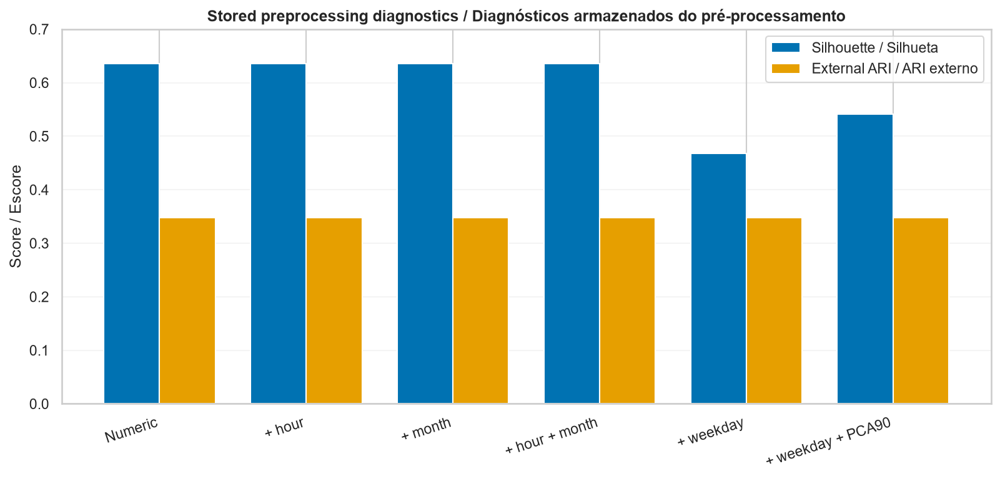

# Descobertas Iniciais

!!! warning "Evidência exploratória"
    Estas observações vêm da EDA atual e de artefatos locais regenerados. Elas não são
    resultados de uma avaliação congelada nem recomendações de produção.

## Perfil do conjunto de dados

- 35.040 medições e 11 colunas;
- nenhum valor ausente ou linha exatamente duplicada;
- frequência de 15 minutos ao longo de 2018;
- 25.056 observações em dias úteis e 9.984 em fins de semana;
- contagens de `Load_Type`: 18.072 `Light_Load`, 9.696 `Medium_Load` e 7.272
  `Maximum_Load`.

## Impressões das distribuições

Consumo, energia reativa atrasada, energia reativa adiantada e CO2 têm assimetria à
direita. O fator de potência adiantado tem forte assimetria à esquerda. A regra do IQR
marca cerca de 23,8% das observações do fator de potência adiantado e 22,1% das
observações de energia reativa adiantada como extremas; isso reflete o formato das
distribuições e não deve ser interpretado como equivalente a uma anomalia operacional.

## Impressões das relações

Os diagnósticos atuais de Spearman mostram:

- forte associação positiva entre `Usage_kWh` e CO2, aproximadamente 0,88;
- associação positiva entre consumo e energia reativa atrasada, aproximadamente 0,64;
- forte associação inversa entre energia reativa adiantada e fator de potência
  adiantado, aproximadamente -0,97;
- estrutura clara de hora do dia e dia útil/fim de semana no consumo médio.

Essas relações motivam escalonamento, verificações de redundância e testes de
estabilidade temporal.

*Figura 1 — Correlação de Pearson calculada a partir das variáveis numéricas brutas, com
`Load_Type` excluído. Ela sustenta o alerta de redundância entre consumo e CO2 e a forte
relação inversa entre energia reativa adiantada e fator de potência adiantado; correlação
não implica causalidade.*

*Figura 2 — Média de `Usage_kWh` por mês e hora. Os blocos recorrentes da manhã e da
tarde sustentam a impressão de padrão temporal, mas o mapa isoladamente não identifica
sua causa operacional.*

## Impressões multivariadas

Os dois primeiros componentes do PCA explicam aproximadamente 73,4% da variância do
espaço transformado. PCA e t-SNE mostram regiões estruturadas, mas as projeções não
provam a existência nem o significado de negócio dos grupos.

Nos diagnósticos de K-Means em uma amostra reproduzível, K=3 apresenta a maior silhueta
testada, aproximadamente 0,449. O baseline completo com três grupos contém atualmente
13.074, 14.378 e 7.588 observações. Isso apoia a continuidade da investigação, mas não é
uma validação externa.

*Figura 3 — Diagnósticos armazenados do K-Means no notebook 01. K=3 é simultaneamente a
hipótese do problema e a maior silhueta entre K=2…8 nesta execução; isso sustenta uma
segmentação plausível, não equivalência com as categorias externas de `Load_Type`.*

No diagnóstico de GMM, o BIC continua melhorando até os oito componentes testados,
enquanto o modelo condicionado pelo problema permanece fixado em três. Isso sugere uma
subestrutura estatística dentro dos três regimes operacionais, não uma evidência de que
o problema de negócio tenha oito regimes.

O Isolation Forest sinaliza 701 observações sob uma taxa de contaminação presumida de
2%. Esses registros são candidatos à investigação, não falhas confirmadas.

O cruzamento pós-hoc com `Load_Type` mostra uma concentração desigual dos sinais: 0,88%
em `Light_Load`, 3,52% em `Medium_Load` e 2,76% em `Maximum_Load`. Como `Load_Type`
descreve carga — e não falha — essa diferença não mede acurácia nem erro do detector. Ela
indica que um score global pode confundir contextos operacionais distintos e motiva a
comparação futura com uma detecção contextual por perfil não supervisionado, hora e tipo
de dia.

A figura pós-hoc correspondente permanece como artefato local gerado; as conclusões
publicadas estão registradas em [Avaliação](evaluation.md).

A distribuição pós-hoc permanece fora do treinamento e descreve concentração de alertas,
não incidência comprovada de falhas.

## Próximas verificações

Essas verificações foram tratadas em [Preparação dos dados](data-preparation.md),
[Modelagem](modeling.md) e [Avaliação](evaluation.md).

- reproduzir a preparação fora do notebook de EDA;
- medir a estabilidade dos grupos com reamostragens e divisões temporais;
- testar a sensibilidade a grupos de variáveis e transformações;
- definir um protocolo congelado de avaliação externa;
- resolver a descrição da unidade de CO2;
- evitar transformar prematuramente rótulos exploratórios em treinamento supervisionado.

## Evidências por notebook

| Notebook | Evidência disponível atualmente | Situação da interpretação |
| --- | --- | --- |
| `01_EDA.ipynb` | auditoria dos dados, distribuições, perfis de calendário, correlações, PCA/t-SNE, K-Means, GMM e Isolation Forest | exploratória |
| `02_Preprocessing.ipynb` | síntese exploratória, protocolo temporal publicado, pré-processamento ajustado e artefatos exportados | protocolo documentado; decisões pendentes de aprovação da equipe |
| `03_Modeling.ipynb` | comparação de candidatos, avaliação final, anomalias e filtro de transições v1.1 | resultado de modelo publicado |

A execução armazenada da EDA também informa ausência de timestamps duplicados, intervalo
constante de 15 minutos e picos recorrentes de atividade aproximadamente entre 9h–11h e
14h–17h. As medianas em dias úteis são 7,60 kWh para consumo e 5,80 kVarh para energia
reativa atrasada, contra 3,46 kWh e 3,02 kVarh nos fins de semana. Esses são padrões
operacionais descritivos, não explicações causais.

## Impressões do notebook de pré-processamento

A síntese exploratória em `02_Preprocessing.ipynb` registra a divisão cronológica 80/20 anterior: o
treinamento vai de 01/01/2018 a 19/10/2018 e o teste vai de 20/10/2018 a 31/12/2018.

| Configuração de variáveis | Silhueta | ARI contra as categorias externas |
| --- | ---: | ---: |
| Baseline numérico | 0,6361 | 0,3482 |
| Numéricas + hora + mês | 0,6361 | 0,3482 |
| Numéricas + `Day_of_week` | 0,4680 | 0,3476 |
| Numéricas + `Day_of_week` + PCA 90% | 0,5409 | 0,3478 |

*Figura 4 — Escores armazenados pelo notebook 02. O gráfico torna visível a tensão da
seleção: o baseline numérico possui a maior silhueta, enquanto o ARI externo varia muito
pouco entre as configurações testadas.*

O pipeline PCA ajustado mantém seis componentes para explicar 90% da variância e informa
correlação máxima entre componentes igual a 0,0 após arredondamento. Entre subamostras, a
configuração final com três grupos apresenta estabilidade ARI de 0,9983 ± 0,0015, uma
forte evidência de repetibilidade para esse pipeline e protocolo de amostragem específicos.

As variáveis de reporte excluídas do ajuste ainda distinguem os grupos: a média de CO2
varia de 0,000 a 0,031 tCO2, enquanto a média do fator de potência adiantado varia de
aproximadamente 38,716 a 99,991. Isso apoia a interpretação posterior ao ajuste, mas não
estabelece validade causal ou de negócio.

!!! note "Comparação exploratória histórica"
    Esses escores 80/20 documentam apenas a exploração anterior. A seleção publicada
    usa o protocolo cronológico treino/validação/teste do notebook 03: K-Means com
    variáveis elétricas obteve silhueta 0,823 e ARI de bootstrap 0,999 na validação.

## Resultado publicado da modelagem

`03_Modeling.ipynb` seleciona K-Means com variáveis elétricas, calibra o Isolation
Forest na validação, avalia o teste congelado de novembro–dezembro e publica o modelo
v1.1. A silhueta no teste é 0,768; o filtro de transições reduz os alertas do teste de
49 para 5, preservando `is_anomaly_raw` para auditoria. Consulte [Modelagem](modeling.md)
e [Avaliação](evaluation.md) para o protocolo completo.
